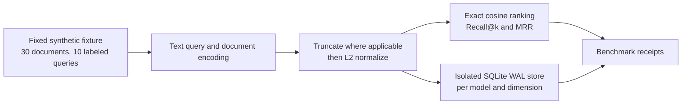
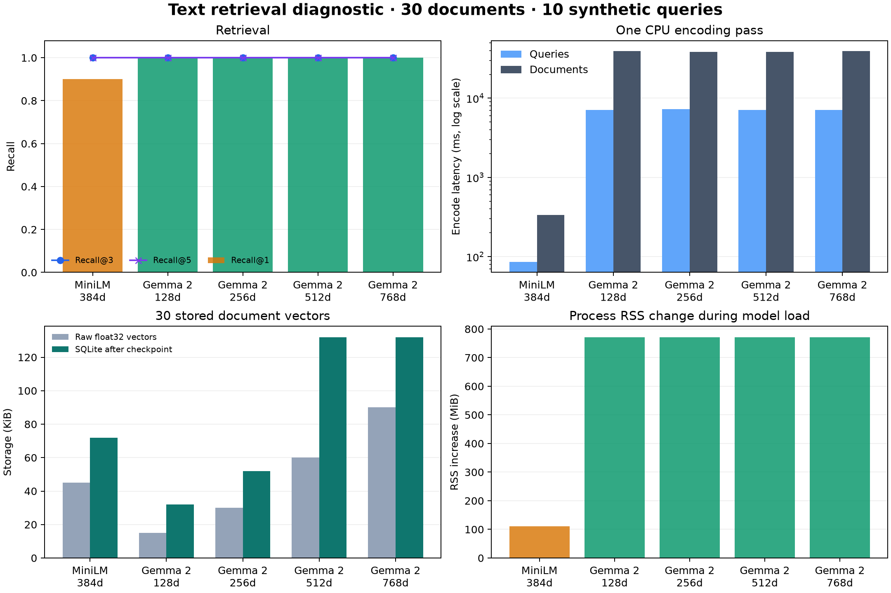

# Report 074: EmbeddingGemma 2 Synthetic Retrieval and Storage Diagnostic

**Classification:** Offline benchmark; diagnostic only

**Date:** 2026-10-14

**Run:** `embedding_mrl_retrieval_20261014_verified`

**Implementation commit:** `00d3a55`

**Fixture:** `embedding-mrl-retrieval-v1`, SHA-256 `1414bf0bb9b127fe65e0a2b813ab1d3dd471cd82909873f6e240770f985f3c51`

**Runtime decision:** Retain MiniLM for current embeddings (2026-10-14).

## Finding

The frozen, hand-authored synthetic set produced perfect retrieval scores for EmbeddingGemma 2 at 128, 256, 512, and 768 dimensions, while MiniLM at 384 dimensions scored 0.90 Recall@1 and 0.95 MRR. The result confirms that the harness ran and that the candidate ranked these ten labeled queries well. Ten queries and thirty synthetic documents are too small and too narrowly constructed to establish production retrieval quality.

On this CPU run, EmbeddingGemma 2's query encoding took about 7.1–7.3 seconds and document encoding about 38.4–39.3 seconds, compared with MiniLM's 86 ms and 334 ms. The observed model-load RSS delta was 808,886,272 bytes (about 771 MiB) for Gemma and 116,514,816 bytes (about 111 MiB) for MiniLM. Lower dimensional Gemma vectors reduced raw vector bytes, but SQLite page and index overhead meant the 128-dimensional database was 32 KiB and the 256-dimensional database 52 KiB after checkpoint; the 512- and 768-dimensional databases were both 132 KiB. These measurements describe one CPU pass on this host, not a deployment profile.

No production database or runtime embedding configuration was changed. The run used text-only inputs and provides no evidence about images, audio, video, or deployment suitability.

The measured CPU document-encoding time (about 38–39 seconds for only 30 documents) is too slow for the current path. Keep MiniLM in the runtime configuration; revisit Gemma only with representative hardware and corpus measurements.

## Method and boundary

The benchmark evaluated the fixed 30-document / 10-query fixture in separate model-and-dimension namespaces and isolated SQLite databases. MiniLM used 384 dimensions. EmbeddingGemma 2 used Matryoshka truncation at 128, 256, 512, and 768 dimensions; truncated vectors were L2-normalized before retrieval. The model prompts used the Sentence Transformers `query` and `document` task routes. Each profile was run once on CPU without a repeated-trial or warm-up protocol.

## Results

| Model | Dimensions | Recall@1 | Recall@3 | Recall@5 | MRR | Query encode (ms) | Document encode (ms) | Load RSS delta (MiB) | Raw vectors (KiB) | SQLite after checkpoint (KiB) |
|---|---:|---:|---:|---:|---:|---:|---:|---:|---:|---:|
| MiniLM | 384 | 0.90 | 1.00 | 1.00 | 0.95 | 85.768 | 334.138 | 111.1 | 45.0 | 72 |
| EmbeddingGemma 2 | 128 | 1.00 | 1.00 | 1.00 | 1.00 | 7,125.023 | 39,264.837 | 771.4 | 15.0 | 32 |
| EmbeddingGemma 2 | 256 | 1.00 | 1.00 | 1.00 | 1.00 | 7,306.133 | 38,420.783 | 771.4 | 30.0 | 52 |
| EmbeddingGemma 2 | 512 | 1.00 | 1.00 | 1.00 | 1.00 | 7,138.503 | 38,520.742 | 771.4 | 60.0 | 132 |
| EmbeddingGemma 2 | 768 | 1.00 | 1.00 | 1.00 | 1.00 | 7,059.462 | 39,292.266 | 771.4 | 90.0 | 132 |

The database-size values are the actual post-checkpoint file sizes, not a linear estimate from vector width. With only thirty records, SQLite allocation and index pages are a substantial part of the total. They should not be extrapolated to production corpus sizes without a larger fixture and representative query mix.

## Interpretation and limits

This run verifies the benchmark path across all five profiles. Its retrieval ranking is not a meaningful head-to-head quality estimate: the labels are hand-authored, the test set is tiny, and the questions may reflect the fixture's construction. No repeated measurements, warm-up exclusion, confidence intervals, GPU profile, or independent human relevance judgments were collected. Timing and RSS are therefore descriptive observations from this run.

The Gemma result exposes a concrete trade-off for follow-up: smaller embeddings reduce vector payload, but the observed CPU encode cost and model-load memory were much higher than MiniLM on this host. A deployment decision needs a production-shaped corpus, independently reviewed relevance judgments, repeated latency/memory measurements, and a storage comparison at realistic scale.

## Next work

- Evaluate against production-shaped `SimpleChunkDigester` / `perception_sediment` text with independently reviewed query-document relevance labels.
- Repeat runs with declared warm-up and measurement windows; assess CPU and intended deployment hardware and use representative corpus sizes for SQLite WAL storage.
- Evaluate image, audio, and video inputs separately before making multimodal claims.
- Keep runtime embeddings unchanged until those evaluations support a reviewed migration decision.

## Reproducibility and artifacts

- [Run summary](artifacts/summary.md)
- [Run metadata](artifacts/metadata.json)
- [Per-query receipts](artifacts/telemetry_receipts.json)
- [Run log](artifacts/run.log)
- Isolated SQLite stores: [MiniLM 384d](artifacts/storage/minilm-384d.sqlite3), [Gemma 128d](artifacts/storage/embeddinggemma2-128d.sqlite3), [256d](artifacts/storage/embeddinggemma2-256d.sqlite3), [512d](artifacts/storage/embeddinggemma2-512d.sqlite3), [768d](artifacts/storage/embeddinggemma2-768d.sqlite3)
- [Benchmark fixture](../../../benchmarks/data/embedding_mrl_retrieval_v1.json)
- [Benchmark implementation](../../../benchmarks/suites/telemetry/embedding_mrl_retrieval.py)
- [Focused tests](../../../benchmarks/tests/test_embedding_mrl_retrieval.py)

The archived run used Sentence Transformers 6.1.0, Transformers 5.19.0, Torch 2.14.1 (CPU), and NumPy 2.5.4. Model revisions and full runtime metadata are recorded in `artifacts/metadata.json`.
