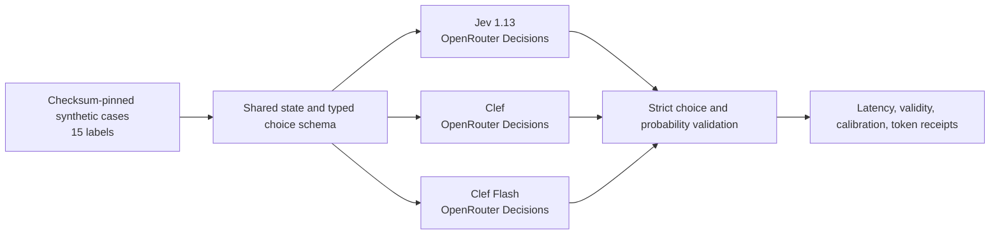
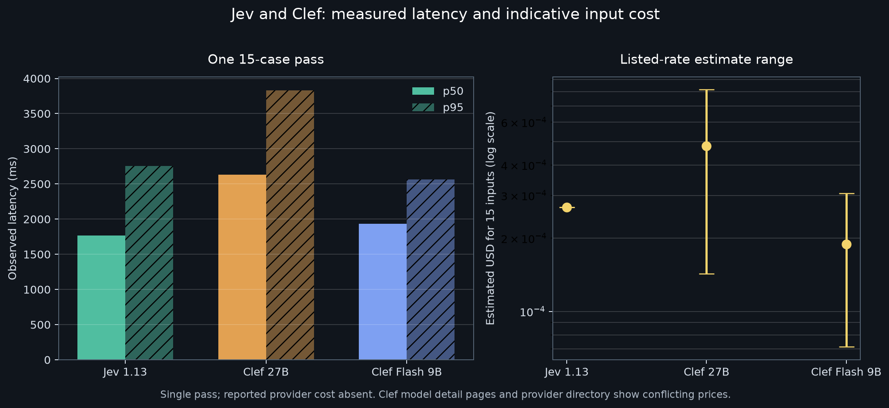

# Report 075: Clef and Jev OpenRouter Comparison

**Classification:** Live provider benchmark; synthetic fixture; diagnostic only

**Date:** 2026-10-14

**Run:** `clef_jev_openrouter_20261014_comparison`

**Benchmark commit:** `09d635a`

**Fixture:** `clef-jev-sensory-v1`, SHA-256 `c61e0890dc9bb3ca1e4f83df3acf0809155ab1495a5ec0ca7431eb77b259e2d9`

## Finding

All 45 requests completed without provider failures. Jev had the lowest observed median latency (1.77 s), Clef Flash was 1.93 s, and Clef was 2.63 s. The runner accepted only responses whose selected choice, confidence, and full probability map passed its strict consistency checks: Jev 8/15, Clef 7/15, and Clef Flash 2/15. Every rejected answer failed `confidence_probability_mismatch`; they were not transport failures. The accepted subset scored 100% on the hand-authored labels for each model, but those subsets are too small and selected by response validity, so this is not a quality ranking.

The OpenRouter response omitted billed cost for every call. Input-token use was 6,388 for Jev and 3,402 for each Clef model. OpenRouter's detailed model pages and Cloudflare provider overview currently show conflicting input prices for Clef and Clef Flash. Applying the displayed rates to these token counts gives indicative batch-cost ranges only; they are not billing receipts. Jev's displayed rate is consistently $0.042 per million input tokens.

The result does not justify routing changes. Clef Flash was closest to Jev's median latency but had only two answers that met the probability consistency contract. Repeat runs and independently judged labels are needed before any further evaluation of runtime use.

## Method and boundaries

The checksum-pinned synthetic fixture contains 15 cases across triage, search filtering, sycophancy checks, tension nomination, and dream arbitration. Each was evaluated once by `typesafe/jev-1.13`, `cloudflare/clef`, and `cloudflare/clef-flash` through OpenRouter's typed Decisions interface. All providers received the same state and choice schema. The runner records a response as valid only when the chosen option is in-schema, probabilities cover every option and sum to one, and confidence agrees with the selected option's probability within 0.05.

The benchmark made one sequential pass. Its p95 over fifteen observations is the slowest observed case, not a stable tail-latency estimate. Latency includes this runner's request path and provider service. No production routing or provider configuration was changed.

## Results

| Model | Valid answers | Invalid answers | Accepted-set accuracy | Abstentions | p50 ms | p95 ms* | Input tokens | Listed price detail page / directory card (USD per 1M input tokens) | Estimated 15-call input cost** |
|---|---:|---:|---:|---:|---:|---:|---:|---:|---:|
| Jev 1.13 | 8/15 | 7 | 1.00 (n=8) | 1 | 1,765.654 | 2,754.587 | 6,388 | 0.042 / 0.042 | 0.000268 |
| Clef | 7/15 | 8 | 1.00 (n=7) | 0 | 2,633.489 | 3,831.953 | 3,402 | 0.24 / 0.042 | 0.000143–0.000816 |
| Clef Flash | 2/15 | 13 | 1.00 (n=2) | 0 | 1,933.825 | 2,566.387 | 3,402 | 0.09 / 0.021 | 0.000071–0.000306 |

\* With one pass over fifteen cases, p95 equals the slowest observation in that group.

\** Estimated as input tokens × listed rate ÷ 1,000,000. OpenRouter reported no per-call cost; output tokens are listed as free on the cited model pages. Price ranges reflect the conflicting model-detail and provider-directory listings observed on 2026-10-14. Verify current rates and actual billed usage before projecting costs.

## Interpretation

Jev had the best median latency and the highest strict-validity count in this pass. Clef was about 49% slower than Jev at p50; Clef Flash was about 10% slower. Clef used fewer input tokens for the same fixture, but its listed price varies by page and the provider did not return billed cost. On the detailed model pages, Clef's per-token price is higher than Jev's; the Cloudflare overview lists Clef at Jev's rate and Flash at half Jev's rate. The disagreement prevents a firm price winner from this run.

The strict validator rejected 28 of 45 successful provider responses because confidence differed from the chosen option's probability by more than 0.05. This is a concrete contract compatibility issue for these responses. The report does not loosen that check or infer correctness from answer text. The fixture's labels were hand-authored rules, not independent human judgments; its 100% accepted-set accuracy does not establish generalization.

## Reproducibility and artifacts

- [Run summary](artifacts/summary.md)
- [Run metadata](artifacts/metadata.json)
- [Per-case receipts](artifacts/telemetry_receipts.json)
- [Sanitized run log](artifacts/run.log)
- [Fixture](../../../benchmarks/data/clef_jev_sensory_v1.json)
- [Runner](../../../benchmarks/suites/telemetry/clef_jev_comparison.py)
- [Focused tests](../../../benchmarks/tests/test_clef_jev_comparison.py)
- Model pricing pages checked 2026-10-14: [Jev 1.13](https://openrouter.ai/typesafe/jev-1.13/api), [Clef](https://openrouter.ai/cloudflare/clef), [Clef Flash](https://openrouter.ai/cloudflare/clef-flash), and [Cloudflare model overview](https://openrouter.ai/cloudflare).

Receipts exclude fixture text, response text, provider error bodies, and credentials. They preserve only input hashes, selected choices, accepted probability maps, validation reason, timings, returned model labels, and usage fields.
